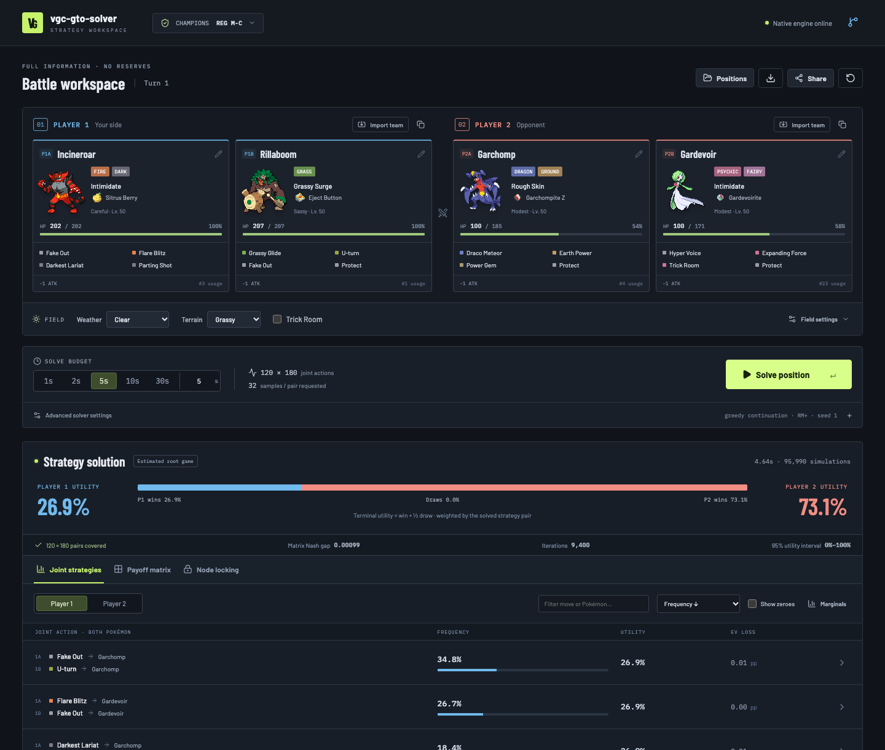

# vgc-gto-solver

A Rust research solver for restricted Pokémon Champions VGC endgames. It enumerates complete
simultaneous joint actions, estimates expected **terminal battle utility** with full-game Monte
Carlo rollouts, and solves the resulting constant-sum matrix using regret matching or RM+.

**Current status:** an interactive React/TypeScript strategy workspace backed by native Rust,
with an editable battle board, published presets, imports, asynchronous solving, strategy/matrix
views, node locking and seeded turn exploration. The CLI and research checks remain available. It does **not** solve the full extensive-form
battle game or establish competitive playing strength. A small matrix Nash gap does not mean
the sampled payoffs or continuation policies are accurate.

## Open the application

Install [Rust/rustup](https://rustup.rs/) and Node 24 LTS. Then:

```sh
git clone https://github.com/sandsowkd/vgc-gto-solver.git
cd vgc-gto-solver
npm ci
npm run dev
```

Open **http://127.0.0.1:5173**. The first launch compiles the release-mode Rust backend.
Click a Pokémon to edit its set, select a solve budget, and press **Solve position**.
Use **Turn explorer** to advance real engine actions and re-solve. No account is required.

The local snapshot includes 293 base species/forms and 565 validated published/suggested
presets, attributed VGCPastes sources, and October 2026 Smogon Regulation M-C usage. Art loads
from Pokémon Showdown. All mechanics, legality, resultant stats and solves use pinned native data.

For production: `npm run build && cargo build --locked --release --bin server`, then
`./target/release/server` serves the app on **http://127.0.0.1:8787**.
See [application architecture, deployment, API, controls and limits](docs/web-app.md) and
[data provenance / design research](docs/ui-research-and-data.md).



## Rust CLI

Install [Rust/rustup](https://rustup.rs/); the repository pins Rust 1.100.0. Then:

```sh
git clone https://github.com/sandsowkd/vgc-gto-solver.git
cd vgc-gto-solver
cargo build --locked --release

# Human-readable strategies, frequencies and EVs
cargo run --locked --release -- solve examples/doubles.json --samples 32 --threads 10

# Full JSON: both mixed strategies, every action EV, matrix, counts, intervals and timings
./target/release/vgc-gto-solver solve examples/endgame.json --samples 256 --json > result.json

# Soft 2-second budget; insufficient coverage produces diagnostics with solution: null
./target/release/vgc-gto-solver solve examples/doubles.json --samples 1000000 --budget-ms 2000 --json

# Inspect targets/Mega variants and export the underlying decision-boundary projection
./target/release/vgc-gto-solver inspect examples/doubles.json

# Generic matrix game, independently of Pokémon
./target/release/vgc-gto-solver matrix examples/matching-pennies.json

# Whole-battle value reference for a tiny position with known terminal outcomes
./target/release/vgc-gto-solver exact-reference examples/two-hit-race.json --decisions 2
```

The Rust CLI requires no Node process, web server or game-data download at runtime. The first
Cargo build downloads the pinned simulator/dependencies. The GitHub repository, Rust package
and application are named `vgc-gto-solver`.

## Supported input

Supply JSON with exactly one source: `teams`, `packed_teams`, or `projection`. Explicit or packed
teams contain one to four Pokémon. The first two lead and any others start as reserves. Legal
moves, switches, targets and Mega choices are optimized as joint actions. See the
[four-on-four example](examples/four-v-four.json).

```json
{
  "teams": [
    [{"species":"Garchomp","ability":"Rough Skin","nature":"Jolly",
      "points":[2,32,0,0,0,32],"moves":["Dragon Claw","Protect"],"hp":82}],
    [{"species":"Charizard","ability":"Blaze","nature":"Timid",
      "points":[2,0,0,32,0,32],"moves":["Air Slash","Protect"],"hp":65}]
  ],
  "seed": 23
}
```

Points are **Champions stat points**, ordered HP/Atk/Def/SpA/SpD/Spe: max 32 per stat, 66 total,
not main-series EVs. Species, abilities, supported mechanics, learnsets, PP and HP are checked
against the pinned format. This is a reduced experimental game, not a legal six-mon roster
validator. Held items are optional. Omitted `nature` is Hardy; omitted points are zero.

Optional per-mon overrides: `hp` (0 marks a fainted slot), `status` (`brn/par/psn/tox/slp/frz`),
`status_turns`, `toxic_stage`, `boosts` (Atk/Def/SpA/SpD/Spe/accuracy/evasion), `pp`, `active_turns`.
Overrides apply **after entry effects**, before replay. Omitted boosts preserve Intimidate/entry
effects. Use `replay` for exact histories, including repeated Protect, two-turn moves and Mega:

```json
"replay": [["move 4, move 4", "move 4 mega, move 4"]]
```

Each pair is an engine decision using Showdown choice syntax. Targets 1/2 are foes, -1/-2
own slots, 0 automatic/spread/self as allowed by the engine. A `switch 3` sends in the third entry
in the engine’s current roster order. Use an empty string for a waiting side. Replay into a replacement
decision if a lead should start fainted with a living reserve. Optional top-level `field` sets
`weather`, `weather_turns`, `terrain`, `terrain_turns`, `trick_room`; canonical IDs include
`sunnyday`, `raindance`, `sandstorm`, `snow`, `electricterrain`. Optional `side_conditions` is a
two-element array with `tailwind`, `reflect`, `light_screen`, `aurora_veil` durations. `turn` can
set the current turn number. Inspect `examples/` and `src/battle.rs` for the complete schema.

`packed_teams` accepts two Showdown packed strings with explicit ability names and Champions
points in the EV field. The browser additionally imports human-readable Showdown text and
allowlisted PokePaste URLs, with explicit Champions SP validation.
For an advanced boundary state, save the `projection` object from `inspect` into
`{"projection": ..., "seed": 23}`. Normal RNG history is reseeded on import; this is not a
lossless arbitrary Showdown checkpoint. Teams plus replay are preferred for reproducibility.
Terminal roots, pending choices, reserves and queued mid-turn snapshots are rejected.

## Configuration and output

`solve --config config.json` accepts:

```json
{
  "sampling": {
    "samples_per_cell":32,"max_turns":256,"seed":1,"threads":0,
    "policies":["greedy","greedy"],"confidence":0.95
  },
  "solver":{"iterations":50000,"tolerance":0.001,"algorithm":"regret_matching_plus"},
  "budget_ms":null
}
```

CLI overrides include `--samples`, `--threads` (0=Rayon default), `--seed`, `--policy`,
`--max-turns`, `--budget-ms`, `--iterations`. Policy options are random, greedy and tactical.

JSON reports all legal action frequencies, action EVs in explicitly named perspectives,
terminal-utility payoff estimates, matrix gap/iteration count, win/loss/draw counts, standard
errors, conservative simultaneous confidence bounds, truncation rates and runtime breakdown.
Every legal root pair is considered before refinement. Fixed-work cell results are reproducible
across thread counts. Wall-clock sample counts can differ across runs and machines.

If any root cell is missing or any rollout is capped, `solution`/point `payoff` are null;
per-cell counts and censoring/confidence bounds remain available. Capped games are never
silently draws. Budget checks finish started rollouts, so limits are cooperative rather than
hard real-time. The reported strategy utility includes 0.5 draw credit.

## Verification and experiments

```sh
cargo fmt --all -- --check
cargo clippy --locked --all-targets -- -D warnings
cargo test --locked --release
npm run build
npx playwright install chromium
npm run test:e2e

python3 -m venv .venv
.venv/bin/pip install -r scripts/requirements-research.txt
.venv/bin/python scripts/validate_lp.py

# Node 22+ is needed only for the pinned Showdown differential reference
bash scripts/setup-reference.sh
.venv/bin/python scripts/validate_showdown.py

./target/release/vgc-gto-solver bench examples/doubles.json --policy random --games 2000
./target/release/vgc-gto-solver match examples/held-out.json --a tactical --b greedy --pairs 200
./target/release/vgc-gto-solver match examples/endgame.json --a solver --b greedy --pairs 50 --solver-samples 16
.venv/bin/python scripts/run_benchmarks.py
```

Measured on Apple M5: a 60×96 root matrix with 32 rollouts per pair took about **3.6–3.7 s**
across three seeds; observed utility and strategies varied considerably. Fifteen seeded games
matched Showdown on 183 complete state comparisons. Both algorithms passed 128 independent
LP comparisons (maximum value error <0.001). See [benchmarks](docs/benchmarks.md) for actual
throughput, budget failures, intervals and playing-strength results. The initial solver has
**not** demonstrated an advantage over greedy on the small endgame evaluation suite.

## Limitations and next work

The solver uses pinned Reg M-C, perfect information, and up to four Pokémon per side. Ninjask owns
battle mechanics. Seeded comparisons cover specific Showdown traces. Tactical policies are early
heuristics with limited switch strategy. Large all-pair
matrices are sample-hungry: 32 samples/cell gave unstable strategies and wide statistical bounds
despite an estimated matrix gap near 0.001. No learned values, depth search or hidden-set modeling is included. The browser is a research
interface; arbitrary replay-state edits require returning to setup.

Start with [PROGRESS.md](PROGRESS.md), [ROADMAP.md](ROADMAP.md),
[simulator research](docs/simulator-research.md) and [algorithms](docs/algorithms.md).
The highest-value next step is reliable held-out strategy evaluation plus variance reduction/
confidence-driven allocation, followed by stronger continuation policies.

Dependency/data notices are in [THIRD_PARTY_NOTICES.md](THIRD_PARTY_NOTICES.md).
The owner has not selected a blanket license for vgc-gto-solver's original source yet.
